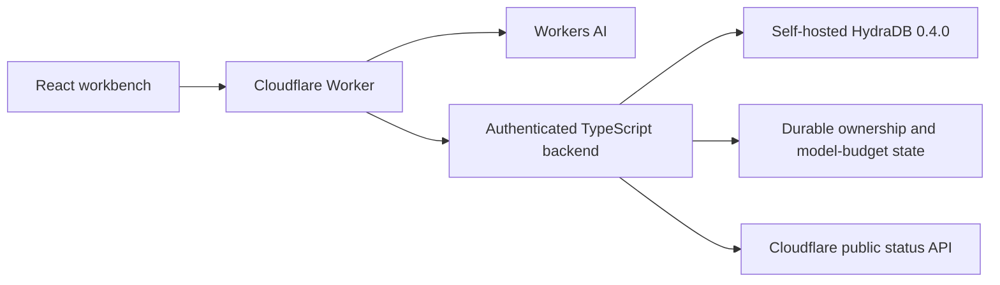

# Incident Context

An incident-response agent context layer for platform and on-call teams, built on the self-hosted HydraDB graph engine.

[Open the live workbench](https://incident-context.dpratik3005.workers.dev) · [Source repository](https://github.com/PRADDZY/incident-context) · [Measured results](docs/results.md) · [Setup and operations](docs/operations.md)

An incident agent needs the right tools, their prerequisites, and the correct service identity. Incident Context resolves an alias such as `checkout`, traverses the applicable skill and tool dependencies in HydraDB, and supplies a complete tool bundle within a 4,096-byte schema budget. The workbench shows the exact schemas, supporting graph edges, Cypher receipts, tool observations, and session feedback.

This is a HydraDB hackathon **Track 2: agent context layer** prototype. Its strongest measured result is context reduction. The initial learning curve was flat; a separate goal-oriented supplement gained one held-out case and then plateaued.

## Try it

1. Open the [workbench](https://incident-context.dpratik3005.workers.dev). The first scenario, **Checkout rollout regression · Sandbox**, compiles automatically.
2. Select the **Northstar Checkout** service node to inspect its canonical service and resource IDs. Expand **Query receipt** to see the actual HydraDB queries.
3. Expand a tool in **Tool bundle**, then **JSON schema**. Compare **Full catalog** with **Learned graph**; switching strategy recompiles without calling the model.
4. Click **Run agent** once. Inspect **Agent observations**, source labels, model usage, and **Run metadata**. Failed or incomplete runs remain visible.
5. Submit **Correct** or **Incorrect** only after inspecting the returned evidence. Feedback changes this browser session's skill counts, with an inspectable receipt.
6. Try **Search provider observation · Live provider**, or open **Evidence** for the original benchmark and **Catalog** for all 12 tools.

The public demo shares a durable limit of 60 reserved model attempts per UTC day. Compiling context and reading evidence do not consume model calls. An exhausted budget or unavailable graph is reported as an error. Use the [tester guide](docs/tester-guide.md) for a short structured trial.

## What is real, and what is simulated?

| Component | Source and scope |
| --- | --- |
| Graph storage and traversal | Real, self-hosted open-source HydraDB 0.4.0. Alias resolution, prerequisite traversal, server metadata, session memory, and feedback use the engine. No in-memory graph fallback. |
| Model | Cloudflare Workers AI; requested endpoint `@cf/meta/llama-3.1-8b-instruct-fp8-fast`. The paired study returned `@cf/meta/llama-3.1-8b-fast-v2`; both identities are retained. |
| Service incidents | Four simulated service fixtures: Northstar Checkout, Cedar Dispatch, Juniper Search, and Harbor Ledger. Metrics, logs, releases, owners, runbooks, dependencies, and incident history are sandbox data. |
| Provider tools | Read-only calls to Cloudflare's live public status API. Results include source URLs and observation timestamps. Provider status is context; it does not establish an application's health or root cause. |
| Tool servers | The fixed catalog carries `incident-sandbox` and `cloudflare-status` server metadata. This prototype does not discover or connect arbitrary external MCP servers. |

The model chooses one batch of at most four tool calls. The backend validates selected tools and arguments, executes bounded read-only handlers, and assembles the **Observed diagnosis** from returned observations. This is not an unrestricted autonomous incident responder; it performs no production changes or rollbacks.

## Measured comparison

All studies preserve failed cases and keep held-out requests out of feedback. Schema bytes are exact UTF-8 JSON of the model tool array, not total prompt tokens. See [results and interpretation](docs/results.md), the [original protocol](docs/evaluation.md), and the [supplement preregistration](docs/ambiguity-protocol.md).

**Original deterministic study:** 180 execution attempts, 40 training narratives and 20 held-out narratives over four underlying service fixtures. The fixed workflow calls the real executor without an LLM.

| Context strategy | Executor success on 20 held-out requests | Mean schema bytes |
| --- | ---: | ---: |
| Full catalog | 20 / 20 | 6,560 |
| Keyword baseline | 19 / 20 | 3,882 |
| Frozen graph | 20 / 20 | 1,976 |
| Learned graph | 20 / 20 | 1,976 |

The learned graph used **69.9% fewer schema bytes** than the full catalog with the same observed executor success. Its curve was **20/20 at 0, 10, 20, and 40 training outcomes**. This study measured no learning gain.

**Paired live model study:** 10 fixed tasks, once per strategy, 30 requests total, no retries.

| Context strategy | Model-path executor success | Mean reported input tokens | Usage denominator |
| --- | ---: | ---: | ---: |
| Full catalog | 7 / 10 | 2,320.9 | 10 returned runs |
| Frozen graph | 9 / 10 | 900.67 | 9 returned runs |
| Learned graph | 10 / 10 | 912.4 | 10 returned runs |

The frozen arm's tenth request returned HTTP 502 for an invalid tool-call count; its missing usage is not treated as zero. Learned graph mean input tokens were **60.7% lower than full catalog**. Frozen and learned model inputs were identical in all **9/9 comparable pairs**, so the 9-to-10 success difference is not evidence that learning improved the model. Ten paired tasks do not support a significance claim.

**Goal-oriented supplement:** 40 narratives authored by a separate AI sub-agent blind to the planner, skills, tools, original corpus, and previous results, locked before requests at commit `68a05a8`, then 160 deterministic attempts with no model calls. The curve was **14/20 → 15/20 → 15/20 → 15/20** at 0/5/10/20 training attempts; those 20 attempts produced 16 actual feedback updates. Final independently graded goal success was full catalog **15/20**, keyword **11/20**, frozen graph **14/20**, and learned graph **15/20**. Mean schema bytes were 6,560 / 3,925 / 2,067 / 1,996 respectively, excluding unavailable byte measurements from failed plans.

That is a small one-case gain with an early plateau and **five retained held-out failures**, using the same four service fixtures. Its independent goal-success metric differs from the initial executor-success metric. It supplements the original flat result; it does not replace it or establish broad incident generalization. Raw evidence: [original summary](evaluation/results.json), [original cases](evaluation/resultsdetail.json), [live cases](evaluation/live-results.json), [supplement summary](evaluation/ambiguity-results.json), and [supplement cases](evaluation/ambiguity-resultsdetail.json).

## Why a graph?

The stored relationships do specific work: alias → canonical service → resource; skill → tools → recursive prerequisites; tool → server; session → resolved service and feedback counts. The UI draws returned receipt edges, not an invented service-to-skill relationship. A schema chosen by keyword can omit a prerequisite; the graph planner selects a whole dependency closure or abstains when it is incomplete or over budget.

The comparison evaluates these selectors on HydraDB. It does not prove that a graph database outperforms every relational or document implementation; another store could reproduce the behavior with equivalent identity, dependency, and session logic. [Architecture](docs/architecture.md) describes the actual traversal boundary; [reliability evidence](docs/reliability.md) records separately verified runtime checks.

## Architecture



The Worker serves the interface, proxies the allowed API routes, and owns the model call. The Linux backend owns graph access and tool execution. Tokens stay on the server side. Session skill usefulness starts from Beta counts 1/1; learned selection combines lexical relevance with `successes / (successes + failures)`. Frozen selection uses the initial counts. Published benchmark sessions reject subsequent feedback.

The public API exposes bootstrap, plan, run, feedback, evaluation, and health routes. It exposes no raw Cypher proxy. See [contracts](src/shared/contracts.ts), [backend notes](src/server/README.md), and [operations](docs/operations.md) for details.

## Develop and reproduce

Use the Node.js version, pinned HydraDB image, credentials, and host setup in [operations](docs/operations.md). Install the locked dependencies from a checkout:

```sh
npm ci
npm run cf:types
npm run typecheck
npm run typecheck:worker
npm test
npm run build
```

`npm run dev` starts the Vite interface at loopback; it does not start the graph/backend or provision a model binding. `npm run server` starts the authenticated backend when its required environment is configured. Use the operations guide for the integrated local Worker flow and deployment.

`npm run evaluate` and `npm run evaluate:live` run the original protocols after their documented environment is configured. Live evaluation consumes model budget. Both refuse to overwrite existing evidence; preserve the published artifacts and use new output paths for a new complete experiment. The supplementary command and integrity checks are documented in [its protocol](docs/ambiguity-protocol.md).

## Product scope and submission

The intended buyer is a platform team maintaining an incident agent with multiple tools. The hypothesis is that inspectable dependency-aware context reduces schema overhead and makes missing context easier to debug. Customer demand, willingness to pay, incident-resolution time, production integrations, and large-catalog scaling remain unvalidated. See [go-to-market drafts](docs/go-to-market.md), [the three-minute silent script](docs/demo-script.md), and [submission checklist](docs/submission-checklist.md).

The hackathon asks for a Loom. Only a script is prepared here; no video or Loom link is available. The separate SelfGraph bounty work, [PR #49](https://github.com/hydra-db/selfgraph/pull/49), is not this submission and is not a claimed bounty win.

Application source is [MIT licensed](LICENSE). HydraDB and other dependencies retain their own licenses.
